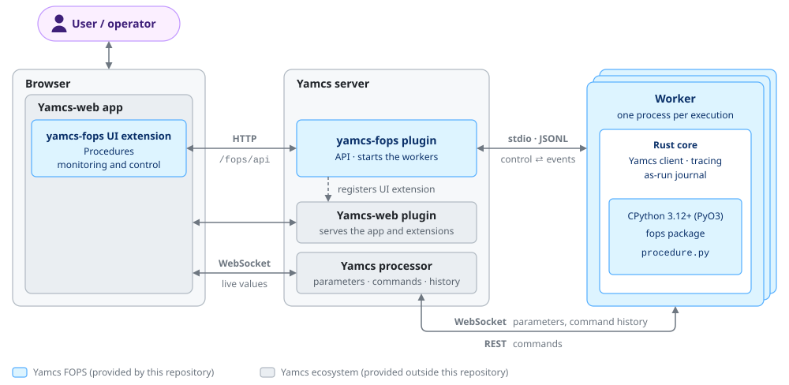

# Yamcs FOPS

Flight (and test) operations procedures for Yamcs. Procedures are written in Python
against a package generated from the Yamcs MDB. Each execution runs in its own
worker process, `fops run` (Rust, embedding CPython), one traced line at a time,
and is monitored and controlled from a web browser.

The web UI and the API are a Yamcs plugin: the fops pages are part of
Yamcs-web, on the Yamcs server's own port, with Yamcs users and privileges.
There is no separate fops server. The plugin starts the workers; each worker
talks to Yamcs directly, for telemetry and commands.

The main concepts in Yamcs FOPS are based on the ECSS standard ECSS-E-ST-70-32C
"Test and operations procedure language". See [docs/ecss-e-st-70-32c-compliance.md](docs/ecss-e-st-70-32c-compliance.md).



The workers can also run on another machine than Yamcs, under `fops runner`:
[docs/remote-workers.md](docs/remote-workers.md).

How the worker is built, and the split between Rust and Python:
[docs/worker.md](docs/worker.md).


## Add fops to your Yamcs

For a Yamcs 5.14 server you already run. Yamcs FOPS is two pieces: the plugin
`yamcs-fops` (a jar, the web UI inside) and the `fops` worker (a Python
package of the same name, with its core in Rust), installed on the Yamcs host. Both are released together, with the same
version: the plugin on Maven Central, the worker on PyPI.

### 1. Install the worker

Python 3.12 or later on the Yamcs host (Linux, x86_64 or aarch64). In a
virtual environment of its own, for example `/opt/fops`:

```bash
python3 -m venv /opt/fops
```

```bash
/opt/fops/bin/pip install yamcs-fops
```

The package is `yamcs-fops`, like the plugin. It installs the `fops` command
(`/opt/fops/bin/fops`) and the `fops` Python package that procedures import.
Procedures run in this Python: install there what they import besides `fops`
(`pip install 'yamcs-fops[client]'` adds `yamcs-client`, for
`fops.yamcs_client()`).

### 2. Add the plugin to Yamcs

In a Maven Yamcs project (`yamcs-maven-plugin`), add to the `pom.xml`:

```xml
<dependency>
  <groupId>com.jaops.yamcs</groupId>
  <artifactId>yamcs-fops</artifactId>
  <version>0.1.0</version>
</dependency>
```

In a Yamcs installed from its package or tarball, download the jar from
Maven Central into `lib/ext/` instead. It has no other dependencies:

```bash
curl -fLo lib/ext/yamcs-fops-0.1.0.jar https://repo1.maven.org/maven2/com/jaops/yamcs/yamcs-fops/0.1.0/yamcs-fops-0.1.0.jar
```

### 3. Configure it

Add a `fops:` section to `etc/yamcs.yaml` with each instance that gets
procedures:

```yaml
fops:
  executable: /opt/fops/bin/fops   # or just fops, if on the PATH of Yamcs
  instances:
    myinstance:
      processor: realtime
```

That is all that is required. For each instance listed the plugin creates
the bucket `fops-procedures-myinstance` (the procedures) and
`fops-asrun-myinstance` (the as-run journals), and generates the `mdb`
Python package from the instance's MDB at each start. Every option:
[docs/plugin-api.md](docs/plugin-api.md#packaging-and-configuration).

### 4. Give users the privileges

With Yamcs security on, grant the `fops.*` system privileges in
`etc/roles.yaml` (superusers have them all):

| privilege | allows |
|---|---|
| `fops.Monitor` | see procedures and executions |
| `fops.Start` | start executions |
| `fops.Control` | control them, answer prompts |
| `fops.Shell` | evaluate Python in a paused procedure, set variables |
| `fops.Kill` | kill any execution |

Procedures send commands and read parameters as the user who started them,
with that user's Yamcs privileges.

Procedures scheduled on the Yamcs timeline have no such user: with security
on they run as a **service user** you name, and without one their start
fails. Create the user (in `users.yaml`, LDAP or the Yamcs directory; it never
logs in, so it needs no password) and give it `fops.Start` and what the
procedures do: the object privileges `Command` (the commands they send),
`CommandHistory` (their acknowledgements; without it a procedure keeps
waiting for them) and `ReadParameter`. Then add it to the configuration:

```yaml
fops:
  serviceUser: fops-timeline   # for every instance; or per instance, under instances:
```

With security off, timeline procedures run as the System user and need nothing.

### 5. Restart Yamcs and run a procedure

After the restart Yamcs-web has **Procedures** in the instance's sidebar.
Upload a `.py` file to the bucket `fops-procedures-myinstance` (Yamcs-web's
Buckets page), select it in Procedures, click **Open**, then **Run**.
See [A procedure](#a-procedure) for how to write one: parameters and commands
are imported from `mdb`.

## Development

Builds everything from this repository and runs it in a Yamcs with a small
simulated spacecraft (`dev/`), on your machine, in one process.

| tool | version | for |
|------|---------|-----|
| Rust (`cargo`) | 1.85 or later | the worker, `fops` |
| Python | 3.12 or later, with its shared library (`libpython3.X.so`; Debian/Ubuntu: `python3-dev`) | the procedures, run inside the worker |
| Node.js (`npm`) | 22.22+, 24.15+ or 26+ | the web UI |
| Java | 17 or later | Yamcs and the plugin |
| Maven (`mvn`) | 3.9 | building the plugin, running Yamcs |

From the repository root:

```bash
cargo build --release
```

```bash
(cd web && npm ci && npm run build)
```

```bash
(cd plugin && mvn install)
```

```bash
cd dev/yamcs && mvn yamcs:run
```

The UI must be built before the plugin: `mvn install` packs `web/dist` into
the jar, and leaves the UI out if it is missing. Yamcs is up when its log
says `Yamcs started`; open <http://localhost:8090/> (no login), the instance
`simulator`, **Procedures**. The procedure bucket there is the `procedures/`
folder: edits on disk show at once. [dev/README.md](dev/README.md) has the details;
[Demo: the Yamcs simulator](#demo-the-yamcs-simulator) lists the procedures.

Without Yamcs-web: check procedures against an instance's MDB without running
them, and run one procedure from a terminal (events go to stdout, controls
come from stdin):

```bash
./target/release/fops mdb-gen --yamcs http://localhost:8090 --instance simulator --out procedures
```

```bash
./target/release/fops check procedures/*.py
```

```bash
./target/release/fops run procedures/power_cycle.py --control \
    --yamcs http://localhost:8090 --instance simulator --asrun asrun.jsonl
```

Releasing the Python package `yamcs-fops`: [docs/releasing.md](docs/releasing.md).

## A procedure

```python
from fops import Arg, log, procedure, send, snapshot, wait
from fops.units import V, minute, percent
from mdb.SIMULATOR.tc import SWITCH_VOLTAGE_OFF, SWITCH_VOLTAGE_ON
from mdb.SIMULATOR.tm import BatteryCapacity2, BatteryVoltage1, BatteryVoltage3, BusCurrent, BusVoltage

BAT1_ON = BatteryVoltage1 > 20 * V
BAT1_OFF = BatteryVoltage1 == 0

proc = procedure("Battery 1 power cycle", version="1.0",
                 args={"off_time": Arg(float, default=20.0, min=1, max=120, unit="s")},
                 requires=[BAT1_ON, BatteryVoltage3 > 20 * V],
                 invariant=BusVoltage > 20 * V)          # violated: abort, then cleanup

proc.watch(BAT1_OFF & (BatteryCapacity2 < 20 * percent), then="abort",
           message="batteries 2 and 3 below 20 % with battery 1 off")

@proc.step("Batteries charged", goal=BatteryCapacity2 >= 50 * percent, within=10 * minute)
def charged():
    """Skipped when the goal holds, otherwise awaited for up to 10 minutes."""

@proc.step("Battery 1 off", goal=BAT1_OFF)
def off():
    p = snapshot(BusVoltage, BusCurrent)               # one sample, journaled
    log("bus at %d V, %d A" % (p[BusVoltage], p[BusCurrent]))
    send(SWITCH_VOLTAGE_OFF(voltage_num=1), confirm=BAT1_OFF)

@proc.step("Bus on batteries 2 and 3", ensures=BusVoltage > 25 * V)
def bus():
    wait(proc.args.off_time)

@proc.step("Battery 1 on", goal=BAT1_ON, cleanup=True)
def on():
    send(SWITCH_VOLTAGE_ON(voltage_num=1), confirm=BAT1_ON)
```

The language works like this (the full reference is [docs/language.md](docs/language.md)):

- **Telemetry and telecommands come from the MDB, not from strings.** Each
  Yamcs space system becomes a Python package with a `tm` module (its
  parameters) and a `tc` module (its commands): `/SIMULATOR/BusVoltage` is
  `from mdb.SIMULATOR.tm import BusVoltage`, `/SIMULATOR/SWITCH_VOLTAGE_ON`
  is `from mdb.SIMULATOR.tc import SWITCH_VOLTAGE_ON`, or
  `from mdb import SIMULATOR` then `SIMULATOR.tm.BusVoltage`. A parameter and a command may share a name. Every
  parameter is typed: enumerations become `Literal` types, and units and
  descriptions are attached. Commands are functions with keyword-only,
  typed arguments. A typo is an import error, not a runtime surprise.
- **A comparison builds a condition.** `BusVoltage > 25 * V` is a condition
  object, evaluated against fresh telemetry by the runtime, with its
  parameters read in one batch. Used as a boolean (`if event_id ==
  "EVENT_1":`) it raises an error: test it now with `holds(cond)`, which
  journals the values, or read `event_id.value`. Conditions combine with `&`, `|` and `~`; there are
  also `.between(a, b)`, `.is_in(...)`, and `.rises_by(n)`, `.falls_by(n)`,
  `.changes()` relative to a baseline (the start of the step, or of the
  `send`/`verify`/`wait_until`).
- **Units.** `fops.units` gives quantities (`20 * V`, `50 * percent`,
  `5 * minute`). A quantity is converted to the parameter's or argument's
  MDB units; a unit of the wrong kind is an `MdbError`. Plain numbers mean
  the MDB units. Durations take seconds or time quantities.
- **Procedures and steps have conditions.** `requires=` must hold before
  (the operator may recheck, override, skip or abort). `goal=` is the
  step's purpose: if it already holds the step is skipped, so procedures
  can be re-run; otherwise it must hold after the body, within `within=`
  seconds. `ensures=` must hold after the body. `invariant=` is checked
  on every update of its parameters while the body runs; a violation
  interrupts the step. A procedure-level `invariant=` aborts the procedure.
- **Statuses and continuations follow ECSS-E-ST-70-32C.** A step goes
  through preconditions, executing, confirmation, completed, and ends
  confirmed, not confirmed (a condition or an operation failed), aborted
  (the body raised) or not available (skipped, interrupted). Then:
  confirmed continues, not confirmed asks the operator (RESTART STEP,
  CONTINUE, ABORT), aborted aborts. `on_unconfirmed=`, `on_aborted=`
  ("continue", "ask", "abort", "restart") and `restarts=` change that.
- **Cleanup steps** (`cleanup=True`) also run when the procedure aborts or
  finishes early. With a `goal=` they cost nothing when there is nothing to
  undo. Aborting during the cleanup stops it.
- **Watchdogs.** `proc.watch(cond, then="pause"|"abort"|"log")` reacts when
  a condition becomes true. As a decorator, the function is a handler: it
  runs on the procedure's thread, interrupting whatever the procedure was
  doing (a wait, a command, a prompt, a pure-Python loop), then resumes,
  pauses or aborts (`then=`).
- **Commands are always tracked.** `send` journals and fsyncs every stage:
  issuing, issued, each Yamcs ack, completed, failed or timeout. It returns
  when the command completes (`CommandComplete`), and then checks
  `confirm` (with `within` seconds for it to hold). `send(wait=False)`
  returns a handle once the command is issued; `.wait()` does the rest.
  Acknowledgements are followed in the background either way, so a
  command whose wait was interrupted by a jump is journaled `abandoned`
  and then still `completed`. On a failure the operator chooses RESEND,
  RECHECK, SKIP, FAIL STEP or ABORT; pass `on_failure="raise"` or `"skip"`
  to decide in code. SEVERE and CRITICAL commands ask for confirmation
  (a `command` prompt showing the command, its arguments and
  significance); with the `confirm_commands` option every command does.
- **Sub-procedures.** `run("power_cycle.py", args={"off_time": 10})`
  runs another procedure as its own execution (its own journal, page and
  Yamcs activity, the caller's controller) and returns how it ended:
  `status`, `confirmation`, `ok`. One that does not end confirmed is a
  failure like a command's (RESTART, SKIP, FAIL STEP, ABORT).
  `run(..., wait=False)` returns a handle with `.wait()` and `.abort()`.
  Aborting or jumping while waiting aborts it, and so does the caller's
  end. Needs the Yamcs plugin.
- **`snapshot(*params)`** reads several parameters in one sample, so
  decisions see one consistent state; the sample is journaled.
- **Arguments.** `procedure(..., args={"cycles": Arg(int, default=2, min=1,
  max=10, description=...), "mode": Arg(str, choices=["FAST", "FULL"]),
  "off_time": Arg(float, unit="s")})` declares typed arguments (int,
  float, str, bool); one without a default is required. They are given
  with `fops run --args '{"cycles": 3}'` and read as `proc.args.cycles`, also at
  the top level. Missing or ill-typed arguments end the run with status
  `error` before any step. The module docstring is the procedure's
  description; `procedure(author=...)` or `__author__` its author;
  `procedure(duration=...)` how long a run usually takes (for the timeline).
- **Prompts.** `ask(question, options)` returns one of the options;
  `ask(question)` free text; `ask(question, kind="number")` a float.
  `hint=` is shown with the question and `default=` is proposed (an empty
  answer takes it). An answer that does not fit is refused and the prompt
  stays open.
- **Scheduling** is Yamcs's: a `PROCEDURE` activity on the timeline (the
  UI's Schedule…) starts the procedure in the background at its time; fops
  itself only starts now.
- The other calls are `verify(...)`, `wait_until(cond, within=)`,
  `wait(s)` or `wait(until=time)`, `log(msg, level=)`, `finish(msg)` and
  `abort(msg)`. Procedures may import any Python library.
- **Plain scripts.** A file without `procedure()` runs as one step without
  conditions (see `procedures/battery_off.py`): useful in an emergency,
  still tracked and journaled. `fops check` warns about it.

### `fops mdb-gen`

`fops mdb-gen` reads `/api/mdb/{instance}/parameters` and `/commands`
(paged; `--yamcs-token-file` when security is on), or the same listings
from a file (`--mdb`), and writes `procedures/mdb/`. One package is written per space
system, with `tm.py` and `tc.py`; a space system itself named `tm` or `tc`
becomes `tm_` / `tc_`, with a warning. Units come from the MDB unit sets,
or from a short description that is exactly a known unit symbol. Yamcs-internal parameters (`/yamcs/...`, command history, system)
and abstract commands are skipped. Each command records the stages of its
verifiers, inherited ones included, for `send(until=)`; local parameters
are marked `writable`, for `p.set()`. Names that are not valid Python
identifiers are sanitized: `from` becomes `from_`, and the original
`yamcs_name` is kept. `mdb/__init__.py` records the instance, the time of
generation and a fingerprint of the MDB entries the package is made of.
The Yamcs plugin regenerates the package in the procedure bucket when an
instance starts with a different fingerprint ([docs/plugin-api.md](docs/plugin-api.md)).

### `fops check`

`fops check` loads each procedure's top level, which means imports,
`procedure()`, `requires=` and `watch()`, but never its steps. It then scans
the source for these mistakes:

```
power.py:3:  cannot import name 'BatteryVoltag1' from 'mdb.SIMULATOR.tm' (did you mean BatteryVoltage1?)
power.py:4:  cannot import name 'BusVoltage' from 'mdb.SIMULATOR' (it is in mdb.SIMULATOR.tm: telemetry is in .tm, commands in .tc)
power.py:8:  /PUS/tc-ack-start-failure-code: 'INVALID_VOLTAGE' is not one of 'INVALID_PUS_SUBTYPE', 'NOT_IMPLEMENTED', 'INVALID_EVENT_ID', 'INVALID_VOLTAGE_NUM' (did you mean 'INVALID_VOLTAGE_NUM'?)
power.py:9:  /SIMULATOR/BatteryTemperature1 is in C (temperature), not comparable with 5 V
power.py:13: /SIMULATOR/SWITCH_VOLTAGE_ON has no argument 'voltage' (did you mean 'voltage_num'?)
power.py:15: /SIMULATOR/BatteryTemperature1 is telemetry, not a value: a comparison builds a condition (use holds(...) ...)
power.py:17: send(until='Strated'): /SIMULATOR/SWITCH_VOLTAGE_ON has no verifier 'Strated' (did you mean 'Started'?) (its verifiers: Accepted, Started, Complete)
```

This is meant for AI-generated procedures: run the check before a human
reviews the procedure, and feed the output back to the generator.

### Editor support

`vscode/` is a VS Code extension for writing procedures: `fops check` as
you type, with quick fixes; completion of enumeration labels and of MDB
names, adding their import; hovers; the steps and the MDB as explorer
views. See [vscode/README.md](vscode/README.md).

## Demo: the Yamcs simulator

`procedures/` holds procedures for the PUS simulator of the Yamcs
repository, which `dev/` runs inside Yamcs (instance `simulator`, see
[dev/README.md](dev/README.md)). The simulator is a small one: three batteries that can be
switched off and on, a power bus, PUS connection test (ST[17]) and request
verification (ST[1]) reports. The battery capacities run down from 100 % to
0 % in about 8 minutes, then start again.

| procedure              | what it does |
|------------------------|--------------|
| `power_cycle.py`       | Waits for charged batteries (a step goal, up to 10 min), switches battery 1 off, keeps the bus on batteries 2 and 3 for `off_time` seconds, switches battery 1 back on. Invariant: bus above 20 V. A watchdog aborts if batteries 2 and 3 fall below 20 % while battery 1 is off; switching battery 1 on is a cleanup step. |
| `battery_test.py`      | A functional test with arguments and the three kinds of prompts: PUS connection test, then off/on cycles of battery 1. |
| `verification_test.py` | Tests the PUS request verification: a command with all its reports, one without start report, a failed completion and a failed start. The failures are expected: each step catches its `CommandFailed` and checks the telemetry with `ensures=`. |
| `battery_off.py`       | A plain script (no `procedure()`): battery 1 off. |
| `battery_campaign.py`  | Runs `battery_test.py`, then `power_cycle.py`, as sub-procedures. |

Results on 2026-11-08, with `fops run` and through the Yamcs plugin: every
procedure ends confirmed. With the watchdog's threshold raised so that it
fires, it aborts the power cycle while battery 1 is off, and the cleanup
step switches battery 1 back on.

## As a Yamcs plugin

`plugin/` is the Yamcs plugin `yamcs-fops` (Java 17, Yamcs 5.14.0). It
serves the API of [docs/plugin-api.md](docs/plugin-api.md) under `/fops/api/{instance}/` with
Yamcs authentication and the `fops.*` privileges, starts one `fops run`
worker per execution, makes each execution a Yamcs activity (type
`PROCEDURE`, which the timeline can also schedule), and adds the web UI
(`web/`, built into the jar) to Yamcs-web. Installing it:
[Add fops to your Yamcs](#add-fops-to-your-yamcs).

## Tracing

Line tracing uses `sys.monitoring` (PEP 669):

- LINE events are switched on only for the procedure's own code objects,
  nested functions included. Library code, including `fops` itself, is never
  instrumented.
- Each source location reports its first N hits. N is set with
  `--trace-limit` (default 100), per execution, or while the procedure is
  running. After N hits the callback returns `DISABLE`, and CPython stops
  calling it for that location.
- Pause, step, breakpoints, jumps, abort and limit changes call
  `sys.monitoring.restart_events()`, which re-enables every location. A
  procedure in a suppressed hot loop still stops within about 15 ms.
- Some events are never limited: command stages, verification results,
  step transitions, prompts and answers. Each is written to the as-run
  journal before the procedure continues; commands, verifications and
  prompts are also fsynced.
- The plugin coalesces line events for each web
  client and sends only the latest line. A slow client gets a full snapshot, and the
  snapshot always includes the complete command history.


## TODO

- Parallel steps ("until all complete" only), Yamcs events as triggers.
- Giving access to parameter monitoring status, validity and timestamps.

## License

Yamcs FOPS is licensed under the open-source GNU Affero General Public License v3.0, like Yamcs: see `LICENSE`.
