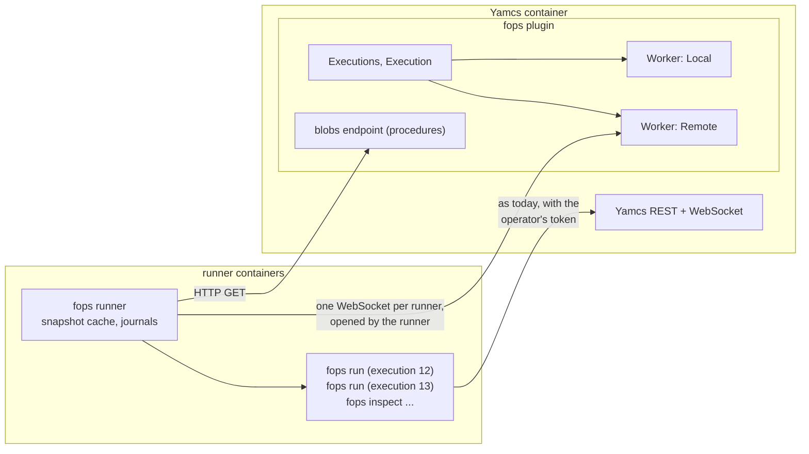

# Remote workers

Today the plugin starts every `fops run` worker, and every `fops inspect`, as
a child process of Yamcs. Procedures are user code: one that allocates
without bound, forks, or spins takes the memory and CPU of the Yamcs
container, and an out-of-memory kill of the container takes Yamcs down with
it. This design moves that user code into a separate container (or host),
the **runner**, so that the worst a procedure can do is kill its own worker,
or at most the runner.

Scope: the worker (`fops run`) and its protocol do not change. Only who
starts it, and how the plugin reaches its stdin, stdout, stderr and files.

Runners are optional. With `workers: local` (the default) the plugin runs
the workers itself, as before, and nothing else is deployed. Most of the
memory protection works there too (see "Isolation" below): it is in
`fops run`, not in the runner.

## Shape



- **`fops runner`**: a new subcommand of the same binary. A long-running
  process that connects to the plugin, and on request spawns `fops run` and
  `fops inspect` exactly as the plugin does today, relaying their pipes.
- **The runner dials Yamcs**, not the other way around. Yamcs is the stable
  address; runners come and go (scaling, restarts, rescheduling) without
  service discovery, Kubernetes API access or configuration in Yamcs. Any
  number of runners can connect; the same works with Docker Compose, a
  second VM, or plain processes.
- **Long-lived runner, process per execution**, not a pod per execution.
  A worker starts in about 100 ms instead of seconds of pod scheduling, Yamcs
  needs no rights on the cluster, sub-procedures do not multiply pods, and it
  is not tied to Kubernetes. A pod per execution can come later as a
  spawning strategy *inside* the runner, without touching the plugin or the
  protocol.
- **Local stays the default.** `workers: local` is today's behaviour, for
  development and single-host installs.

## Isolation

Process separation alone protects Yamcs. The workers are also kept from
killing each other and whatever runs them (Yamcs in local mode, the runner
in remote mode):

- **Memory per worker**: `fops run --memory-limit 512M` sets its own
  `RLIMIT_DATA` (`workerMemory` in local mode, the runner's
  `--worker-memory` in remote mode). Python then raises `MemoryError` in the
  procedure, which ends (`aborted`, "MemoryError") instead of growing. (Not
  `RLIMIT_AS`: thread stacks and mapped files make it unpredictable. cgroup v2
  sub-groups would be exact but need a writable cgroupfs, which Kubernetes does
  not give by default; usable when present.)
- **OOM preference**: a worker started by a server (`--control`) sets its
  own `oom_score_adj` to 1000, so if the machine or container still runs
  out of memory, the kernel kills a worker first, not Yamcs or the runner.
  The runner reports a SIGKILL it did not send, with the container's
  `memory.events` `oom_kill` count increased, as "worker killed: out of
  memory".
- **Capacity**: `--capacity N` procedures running at most (a finished
  worker lingering for variables and eval does not count); a start beyond it
  goes to another runner or is refused (503).
- **Process group**: each worker in its own; kill takes the group, so a
  procedure's subprocesses go too.
- **Bounded output**: an event line over 1 MiB is replaced by a `log`
  event saying so before it is relayed, so a procedure cannot push huge
  objects into the plugin's memory. (Remote mode only.)

What stays in Yamcs: the execution state and its event buffer
(`EventLog`, bounded), the as-run copies, the database rows. Those are
already bounded per execution, except `commands` in the State (all command
records), which should get a cap independently of this design.

## Plugin side

`Execution` does not own a `Process`; it has a `Worker` (`Worker.java`:
`start(listener)`, `send(line)`, `closeInput()`, `kill()`, `isAlive()`; the
listener gets the stdout lines and the exit). `LocalWorker` is the child
process (stderr to the log file). `RemoteWorker` speaks the protocol below,
through `Runners` (the connected runners, the choice of one, inspections)
and `RunnerConnection` (one WebSocket). Abort escalation, linger, sub-procedures,
controller model and activities are above this interface and unchanged.
`WorkerToken` writes to the worker: a `token` control on its stdin (local),
or a `token` message (remote), which the runner writes to the worker's stdin.

`Procedures.inspect` goes through the same switch: in remote mode it asks a
runner (results cached by modification time as today; no runner connected
means no inspection yet, as for a slow one).

## Protocol

One WebSocket per runner at `<contextPath>/fops-runner/connect`, served by
`RunnerHandler`, a plain Yamcs `HttpHandler` that does the WebSocket
upgrade itself (it gets the Netty context and the authenticated user) and
replaces Yamcs's HTTP handlers on that connection. Text frames, one JSON
object each, with a `type`. Executions are keyed `x = "<instance>/<id>"`.
The runner pings every 10 s; 30 s of silence closes the connection on
either side.

Runner → plugin:

```
hello     {runner, version, capacity, executions: [x]}   first message, also on reconnect
started   {x, pid} | failed {x, error}                   answer to start
event     {x, n, line}                a stdout line; n counts from 1 per execution
file      {x, name, offset, end, data}   name "asrun" or "log": bytes offset..end of that file
exited    {x, code, reason?}          after the last event and file data
inspected {req, result} | {req, error}
load      {capacity}                  capacity changed (0: draining)
```

Plugin → runner:

```
start    {x, instance, procedure, manifest: {path: sha256}, flags: [...], token?, user?}
control  {x, line}               a stdin line
close    {x}                     close stdin
kill     {x}
token    {x, token, user}        a renewed access token, or another user's
resume   {x, n, files: {asrun, log}}   after hello: the plugin has events up to n and the files up to these offsets
forget   {x}                     ended and stored: the runner may delete its files
inspect  {req, instance, manifest, path}
```

`flags` are the plugin's command line minus what the runner owns (the
procedure file, `--asrun`, `--yamcs`, `--yamcs-token-stdin`,
`--memory-limit`); the runner adds those. `--yamcs` is the runner's own
`--yamcs` unless it has `--worker-yamcs`.

There are no acknowledgements while connected: a lost connection is the
only way to lose messages, and the `resume` after a `hello` says where to
start again. The runner keeps the latest 50 000 events of each worker for
that, and the files on disk.

### Procedures

A run must use exactly the procedure tree the plugin resolved, and not
change under it. The plugin already keeps a local copy of the procedure
bucket; at start it sends that copy's **manifest** (path → SHA-256, cached
by modification time). The runner builds a snapshot directory per
manifest, of hard links to a content-addressed cache of read-only blobs,
fetching missing blobs with
`GET <contextPath>/fops-runner/blobs/{instance}/{sha256}` (same
authentication; the plugin checks the hash again when serving, and a file
changed meanwhile is a 404 and a failed start). Snapshots unused for 10
minutes are deleted, then blobs in no snapshot. Large generated MDB
packages are fetched once per change, not per run.

(Today a running procedure can see bucket updates when it imports late or
runs a sub-procedure. With snapshots it cannot; a sub-procedure is its own
execution and gets the current tree, as today.)

### As-run journal and log

The worker writes and fsyncs its journal on the runner's disk, as today;
its stderr goes to a file there too. The runner tails both every 100 ms
and sends the appended bytes (the journal by whole lines); the plugin
appends them to its own local files (resent ranges are skipped by offset). So `GET /asrun`, the end-of-execution
upload to the as-run bucket and the restore logic stay as they are. The
runner keeps its copy until `forget`. stderr goes the same way into the
plugin's log file.

The fsync guarantee becomes "fsynced on the runner, and normally in Yamcs
within milliseconds". If the runner's disk must survive the runner pod, give
it a persistent volume; otherwise an `emptyDir` is enough.

### Authentication

- The runner logs in to Yamcs (`/auth/token`) with a **service account**
  (`--client-id`, `--client-secret-file`: client credentials) or a user
  (`--user`, `--password-file`), and connects with its bearer token;
  without either, it connects as Yamcs's guest (security off). The plugin
  requires the system privilege `fops.Runner`, for the connection and the
  blobs.
  The runner receives operators' tokens, so this account is as sensitive as
  the Yamcs host: give it no other privilege, and keep the traffic inside the
  cluster or on TLS.
- Workers authenticate as local ones do: the plugin mints the operator's (or
  the service user's, then the controller's) token and pushes each renewal
  with `token`; the runner writes it to the worker's stdin, never to a file,
  so one worker cannot read another's. Revocation stays in the plugin.

## Failures

| what | effect |
|---|---|
| procedure exceeds its memory | `MemoryError` in the procedure → `aborted`; else OOM kill → `crashed`, "worker killed: out of memory" |
| worker crashes | `exited` → `crashed`, as today |
| runner restarts or its pod dies | its workers' stdin closes: they abort; the plugin, once the connection is gone (at once, or after 30 s of silence for a hung runner) and `runnerGrace` (30 s) has passed, marks them `crashed`: "runner … lost" |
| network blip < grace | workers keep running; on reconnect `hello` lists the runner's executions, the plugin answers `resume`, the runner resends from there; controls sent meanwhile wait in the plugin |
| runner cut off ≥ grace | the runner closes its workers' stdin: they abort (cleanup steps included), as a local worker does when Yamcs goes |
| Yamcs restarts | executions restored `crashed` as today; a runner reconnecting with one of them is told `kill` |
| no runner, or all full | start refused with 503 "no worker capacity" (a timeline activity fails with that reason) |

Both sides use the same grace so that a procedure is never running without
an execution in Yamcs that can control it. Not aborting on a short blip is
deliberate: aborting a procedure mid-pass because of a reconnection is worse
than a few seconds without supervision.

Runner shutdown (SIGTERM, e.g. a rolling update): it stops taking starts
(`load` with capacity 0) and exits once its workers have ended. What is
still running when the container is killed (`terminationGracePeriodSeconds`)
crashes. Workers are in their own process groups, so the SIGTERM to the
runner does not reach them.

Choice of runner: the connected runner with the most free capacity. A
sub-procedure may land on a different runner than its caller; nothing
depends on them sharing one.

## Configuration

`yamcs.yaml`:

```yaml
fops:
  workers: remote        # local (default) | remote
  workerMemory: 512M     # local mode: --memory-limit of the workers
  runnerGrace: 30        # s a runner may be away before its executions crash
  runnerStartTimeout: 20 # s for a runner to answer start (blob fetches included)
```

Runner (`fops runner --help`):

```
fops runner --yamcs http://yamcs:8090 \
    --client-id fops-runner --client-secret-file /run/secrets/fops-runner \
    --capacity 8 --worker-memory 512M --data /var/lib/fops-runner
```

`--name` defaults to the host name (the pod's name), `--grace` (30 s) should
match `runnerGrace`.

`FOPS_PYTHON` and the Python environment are the runner image's; the Yamcs
image no longer needs Python at all in remote mode.

Kubernetes, typically: a Deployment of runners (replicas for capacity),
memory limit ≥ capacity × worker memory + margin, the client secret mounted,
a NetworkPolicy letting runners reach only Yamcs.

## Not done

- Re-attaching running executions after a Yamcs restart (workers survive it
  in remote mode; the plugin would have to restore their live state).
- Runner labels, to pin instances to runners.
- A pod per execution, as a spawning strategy of the runner.
- An example deployment.
