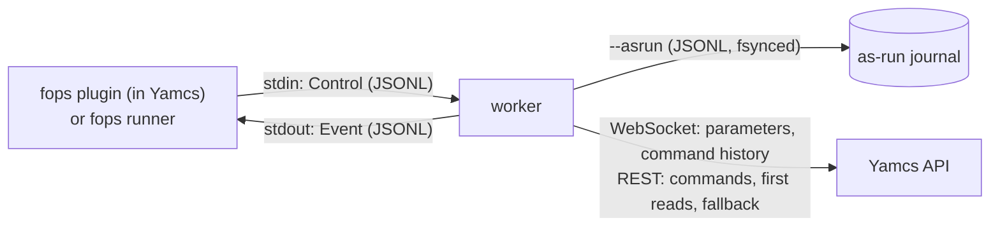

# The worker (`fops run`)

One worker process runs one execution of one procedure. The Yamcs plugin
(or a remote runner, `fops runner`) starts it, sends it control messages on stdin
and reads its events on stdout, one JSON object per line
(`src/protocol.rs`). It also runs on its own from a terminal.

Started by the plugin or a runner (`--control`), a worker sets its own `oom_score_adj`
to 1000: if memory runs out, the kernel kills a worker before Yamcs.
`--memory-limit 512M` caps its data memory (`RLIMIT_DATA`): a procedure
going over gets a `MemoryError`. A worker can also run on another machine,
started by `fops runner` ([remote-workers.md](remote-workers.md)).

## Rust and Python

The procedure language lives in Python (`python/fops/`). The rest is in Rust
(`src/worker/`, `src/yamcs.rs`, `src/yamcs/live.rs`).

| Rust | Python (`fops._runtime`) |
|------|--------------------------|
| embedding CPython, line tracing (`sys.monitoring`), pause, step, breakpoints, jumps, abort | procedures, steps, watches, continuations, statuses |
| every wait: sleeping, prompts, waiting for a command or a telemetry change, all interruptible | conditions: building them, testing them against values, explaining them |
| Yamcs: the connection, the parameter cache, issuing commands, following them | when to read which parameters, and what a result means |
| the as-run journal, the event stream | which events to emit, and their content |

Python reaches Rust through one native module, `_fops` (`src/worker/lang.rs`).
The functions are low level: `get_values`, `wait_change`, `issue_command`,
`wait_command`, `sleep`, `prompt`, `emit`, plus the control hooks. All
waiting goes through Rust for two reasons. Rust releases the GIL while it
waits. And the tracer must be able to interrupt any wait (abort, jump,
violated invariant) and then run service work on the procedure's thread.

The rule of thumb: a change to what a procedure means goes in Python; a
change to how the worker talks to Yamcs, the plugin or runner, or the disk goes in Rust.

## Threads

- **main**: the interpreter running the procedure. Only this thread runs
  procedure code.
- **control**: reads `Control` messages and drives the shared
  `tracer::Control` (mode, breakpoints, answers, requests). When stdin
  closes, the procedure is aborted: nobody can supervise it any more.
- **events**: writes `Event`s to stdout, buffered and flushed when idle.
- **fops-watch** (Python): evaluates watches and the current step's
  invariant, and queues work for the main thread (`request_service`).
- **yamcs-ws**: the Yamcs WebSocket connection (below).
- **cmd-N**: one per command still followed, until it completes or times out.

The main thread sleeps on a single condition variable in `tracer::Control`.
Everything that should wake it notifies it: control messages, prompt
answers, service requests, telemetry updates. `Control::sleep_until(d,
ready)` returns `Elapsed`, `Interrupted`, `Service` (run the queued work,
then sleep again) or `Ready` (`ready()` holds).

## Yamcs

### Parameters

`yamcs::live::Live` keeps the latest value of every parameter the
procedure has read, from one `parameters` subscription per batch of new
names (`sendFromCache`, `updateOnExpiration`).

- **First read of a name**: the value comes from REST
  (`parameters:batchGet`, from the cache), and the name is subscribed. A
  read never waits for the subscription. Unknown names fail there, as
  before.
- **Later reads**: once Yamcs has confirmed the subscription, values come
  from memory. A REST value is only stored if no update came in
  meanwhile, so the cache never goes back in time.
- **Waiting**: every update bumps a version number. `get_values` records,
  per thread, the version it read at. `wait_change(names, timeout)` returns
  as soon as one of the names has been updated after that version: no
  update is lost between a read and the wait. `_evaluate` (behind
  `verify`, `wait_until`, goals, `send(confirm=)`) and the watcher use it.
  They still test again at least every `poll` seconds (0.5 s; 1 s for the
  watcher), so expiry and a dead connection cannot stall them.
- **`read(p, wait=True)`** asks for the *next* value. It stays on REST
  (`fromCache: false`): a subscription's first value is the cached one.

### Commands

Commands are issued over REST with origin `fops`. The `commands`
subscription keeps the history entries of commands with that origin.
Entries are deltas, and they can arrive before the REST call has returned
the command id.

A follower (`cmd-N`) uses the subscription only if it was active before the
command was issued, and stays on the same connection (`commands_epoch`).
Otherwise, and from the first time that stops being true, it polls
`GET /archive/{instance}/commands/{id}` every 100 ms. Each new
acknowledgement is journaled (fsynced) before it is reported.

### Connection

- The connection opens at worker start, so it is usually up before the
  first command.
- With `--yamcs-token-file`, the handshake sends the token. The file is
  read again on each reconnection.
- A ping goes out every 10 s. 30 s with nothing received closes the
  connection.
- On loss, the cache is marked unusable at once: reads go to REST and
  followers to polling, exactly as without a WebSocket. Reconnection backs
  off from 1 s to 10 s, then subscribes again to every name.
- New names wait at most 20 ms to be subscribed (the socket read timeout).

## Journaling and ordering

Command stages, verifications, prompts and answers are written to the
as-run journal and fsynced before the procedure goes on. Line events obey
the trace limit; the others do not. A command still followed when the
procedure ends gets 2 s to complete, then is journaled `untracked`.

## Not done

- Subscribing to the parameters a procedure imports when it loads, to save
  the first REST reads.
- Yamcs events (for `wait until event`) and alarms over the same connection.
- Checking at run time that the MDB fingerprint still matches the instance.
